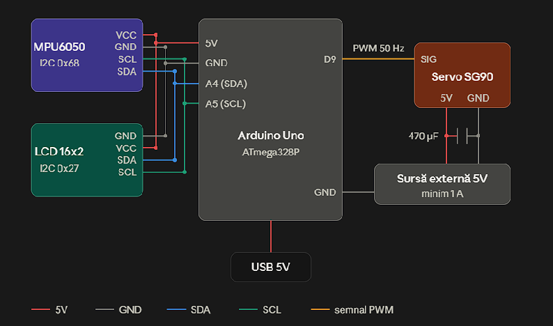

# SIO
Proiectul are ca scop realizarea unei platforme stabilizate pe o singură axă, care rămâne orizontală chiar dacă baza pe care este montată este înclinată. Un senzor inerțial MPU6050 măsoară accelerația și viteza unghiulară, iar Arduino calculează unghiul de înclinare prin combinarea celor două măsurători cu un filtru complementar (giroscopul răspunde rapid, dar derivă în timp, iar accelerometrul este stabil, dar sensibil la vibrații). Un servomotor SG90 rotește platforma în sens opus înclinării, compensând mișcarea, iar unghiul măsurat este afișat pe un LCD 16x2. Proiectul este atractiv deoarece efectul se vede imediat: platforma „stă pe loc” când baza este mișcată, și poate susține un obiect ușor sau o cameră mică. Este simplu de montat, având doar trei periferice și o singură magistrală I2C partajată, și este fezabil, deoarece componentele sunt ieftine, iar algoritmul (filtrul complementar) nu necesită calcule complexe. În arhitectura proiectului găsim o plăcuță Arduino Uno, un modul MPU6050 (GY-521), un servomotor SG90 și un display LCD 16x2 cu modul I2C.

